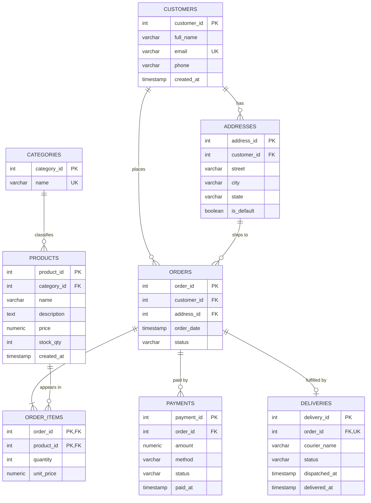

# ER Diagram: MiniPlace

Rendered automatically by GitHub (Mermaid). Crow's-foot notation:
`||` = exactly one, `o{` = zero or many, `|{` = one or many, `o|` = zero or one.

## Relationships explained

| Relationship | Cardinality | Why |
|---|---|---|
| Customer to Address | 1 : N | A customer can save home, office, etc. |
| Customer to Order | 1 : N | A customer can place many orders. |
| Address to Order | 1 : N | Each order ships to one saved address. |
| Category to Product | 1 : N | Each product belongs to one category. |
| Order to Product | M : N | Resolved by the `order_items` junction table. |
| Order to Payment | 1 : N | Failed payment attempts can be retried. |
| Order to Delivery | 1 : 0..1 | Delivery record is created once the order is dispatched (`UNIQUE order_id`). |
